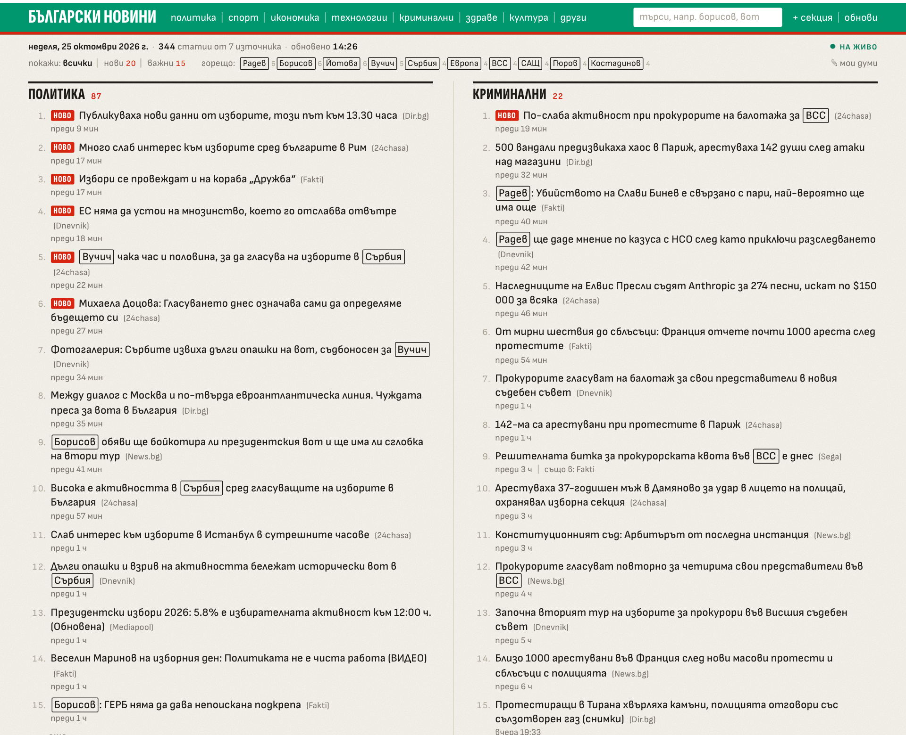
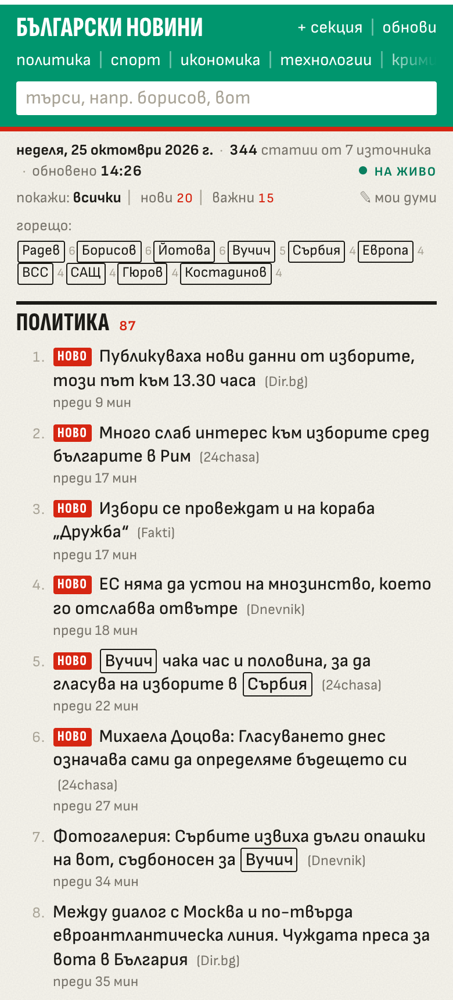

# Bulgarian News Aggregator

<p align="center">
  
  &nbsp;
  
</p>

A real-time news aggregator that collects, classifies and shows the latest news from 7 major Bulgarian outlets on one page — Hacker News density, Bulgarian broadsheet manners.

## What It Does

- **Scrapes 7 sources** — 24chasa, Dnevnik, Fakti, Mediapool, Dir.bg, News.bg and Sega
- **Auto-classifies** articles into 8 categories (Политика, Спорт, Икономика, Технологии, Криминални, Здраве, Култура, Други) with weighted keyword matching
- **Real-time updates** via Server-Sent Events (SSE) — new articles slide into their sections without a page reload
- **НОВО tags** on anything published in the last 30 minutes or that just arrived live
- **Boxed words** — names everyone is covering right now, breaking-news markers and your own words are outlined in every headline (see [What counts as important](#what-counts-as-important))
- **Filter** — `всички | нови | важни`, plus a clickable `горещо:` list of the hottest names
- **Live search** — instant, case-insensitive (Cyrillic included), comma-separated keywords
- **Duplicate grouping** — the same story from several outlets is shown once, with the others listed as "също в: …"
- **Custom sections** — your own keyword sections, plus drag-to-reorder; both remembered per browser
- **Retention** — articles older than 30 days are purged automatically

## The Page

- **The masthead is the flag** — a white rule, a green bar with the wordmark, category links, search and actions, and a red rule.
- **Dateline** — today's date in Bulgarian, the article count, the last fetch time and a live indicator (`НА ЖИВО` / `БЕЗ ВРЪЗКА`).
- **Sections as newspaper rubrics** flowing in two ruled columns; numbered HN-style items with the outlet in brackets and a grey line underneath: `преди 12 мин | също в: Fakti, Sega`. Each section shows 15 items and loads more with `още ›`.
- **Type** is [Sofia Sans](https://fonts.google.com/specimen/Sofia+Sans), a typeface by a Bulgarian foundry that renders proper Bulgarian Cyrillic letterforms (the page is `lang="bg"`).
- On phones the categories become a swipeable row and search goes full width.

## What Counts as Important

Headlines get three kinds of boxes:

| Box | What | Source |
|-----|------|--------|
| ink | **горещо** — names and places at least 3 different outlets used in headlines over the last 12 hours (today: Радев, Борисов, Вучич, ВСС…) | automatic, `importance.py` |
| red | **спешно** — извънредно, спешно, ексклузивно, официално, на живо… | `importance.URGENT_WORDS` |
| green | **ваше** — your own words, set via `✎ мои думи` | stored in the browser |

Hot words skip what isn't news on its own: sentence-opening verbs ("Радев: **Гласувах** …"), question words, "България", and first names that always travel with a surname ("Илияна Йотова" gets one box). Your words match like the classifier: case-insensitive at the start of a word, so `избор` also boxes "изборите"; all-caps words such as `ЦСКА` match exactly.

The `важни` filter keeps stories with a boxed word or covered by 3+ outlets; `нови` keeps the НОВО ones. Empty sections hide while a filter is on, and the hot list refreshes with every fetch.

## Architecture

```
┌─────────────┐     ┌──────────────┐     ┌───────────┐     ┌───────────┐
│  7 Sources  │────>│   Scrapers   │────>│ Classifier│────>│  SQLite   │
│  (RSS/HTML) │     │  (parallel)  │     │ (keyword) │     │    DB     │
└─────────────┘     └──────────────┘     └───────────┘     └─────┬─────┘
                                                                 │
                    ┌──────────────┐     ┌───────────┐           │
                    │  SSE Clients │<────│   Flask   │<──────────┘
                    │  (browsers)  │     │  Server   │
                    └──────────────┘     └───────────┘
```

**Scraping strategy:**
- **RSS feeds** (24chasa, Dnevnik, Fakti, Mediapool, Dir.bg, Sega) — reliable timestamps, clean data, no HTML parsing
- **HTML + article page fetch** (News.bg) — homepage scrape + parallel article page requests for accurate publish times (only for links not already stored)

All timestamps are normalized to `Europe/Sofia`.

## Tech Stack

| Layer | Technology |
|-------|-----------|
| Backend | Flask, SQLAlchemy, SQLite (WAL) |
| Scraping | Requests, BeautifulSoup, lxml (RSS) |
| Real-time | Server-Sent Events (SSE) |
| Frontend | Jinja2 templates, vanilla JS, CSS, Sofia Sans |
| Scheduling | `schedule` library (background thread) |
| Production | gunicorn (1 worker, threads), Docker |
| Tests | pytest, GitHub Actions |

## Project Structure

```
├── app.py              # Flask app, routes, SSE, scheduler
├── wsgi.py             # gunicorn entry point
├── scrapers.py         # All 7 source scrapers (RSS + HTML), duplicate grouping
├── classifier.py       # Keyword-based article categorization
├── importance.py       # Hot words and urgent words
├── models.py           # SQLAlchemy Article model
├── config.py           # App configuration
├── requirements.txt    # pinned runtime deps (requirements-dev.txt adds pytest)
├── Dockerfile
├── tests/              # unit tests + live smoke test of the sources
├── templates/
│   ├── base.html       # Masthead, dateline, modals, client JS (SSE, search, boxes, filter)
│   └── index.html      # Filter bar and category sections
└── static/css/
    └── styles.css
```

## Setup

```bash
git clone https://github.com/dvelkow/real_time_bulgarian_news_aggregator.git
cd real_time_bulgarian_news_aggregator

pip install -r requirements.txt

python app.py
```

The app starts at `http://127.0.0.1:5000` (set `PORT=5055` if macOS AirPlay already holds 5000; `FLASK_DEBUG=1` for the debugger). On first launch it creates the SQLite database, fetches all sources in the background, and begins the 10-minute auto-refresh cycle.

### Production

```bash
gunicorn --workers 1 --threads 32 --bind 0.0.0.0:8000 wsgi:app
```

Keep one worker and no `--preload`: the SSE client list and the scheduler live in that process, and each open browser tab holds one thread. Or with Docker (the database goes to the `/data` volume):

```bash
docker build -t bg-news . && docker run -p 8000:8000 -v bg-news-data:/data bg-news
```

### Tests

```bash
pip install -r requirements-dev.txt
pytest                    # unit tests, no network
LIVE=1 pytest -m live     # checks all 7 real sources still parse
```

CI runs the unit tests on every push and the live check every Monday.

## How the Classifier Works

Each article title is scored against weighted keyword lists for 8 categories. Keywords match at the start of a word, case-insensitively (the stem "парламент" hits "парламентарните", but "ски" no longer hits "Испанският"); acronyms such as ЕС, ДПС and AI match only as exact, case-sensitive words. Multi-word phrases carry higher weights (e.g. "Конституционен съд" = 3 points for Politics). The highest-scoring category wins; if nothing matches, the article goes to "Други".

## Configuration

All settings are in `config.py`:

| Setting | Default | Description |
|---------|---------|-------------|
| `FETCH_INTERVAL_MINUTES` | 10 | Auto-refresh interval |
| `ARTICLES_PER_SOURCE` | 60 | Max articles per scraper |
| `REQUEST_TIMEOUT` | 15 | HTTP timeout in seconds |
| `REFRESH_COOLDOWN_SECONDS` | 60 | Minimum gap between manual refreshes |
| `RETENTION_DAYS` | 30 | Articles older than this are deleted |

Hot-word settings (`WINDOW_HOURS`, `MIN_SOURCES`, `HOT_LIMIT`) are at the top of `importance.py`; the НОВО window is `FRESH_MINUTES` in `templates/base.html`.

Environment variables: `DATABASE_URL` (default `sqlite:///news.db` next to the code), `PORT` and `FLASK_DEBUG` (for `python app.py`).
